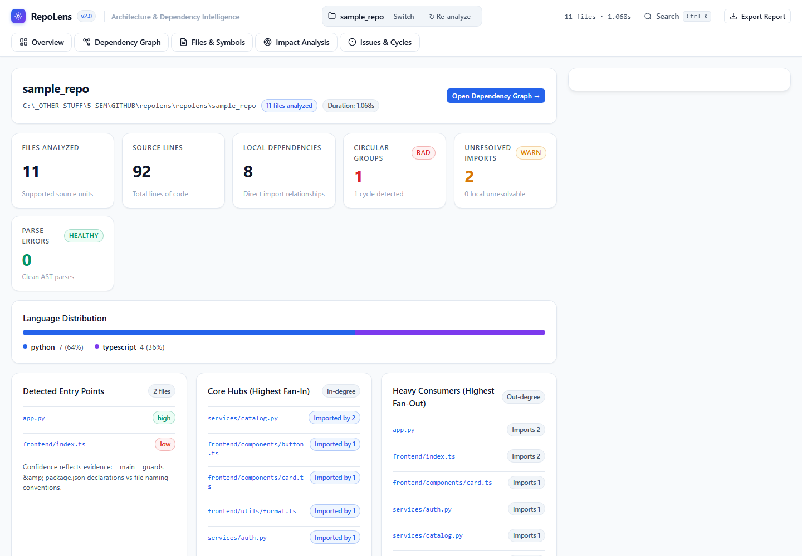
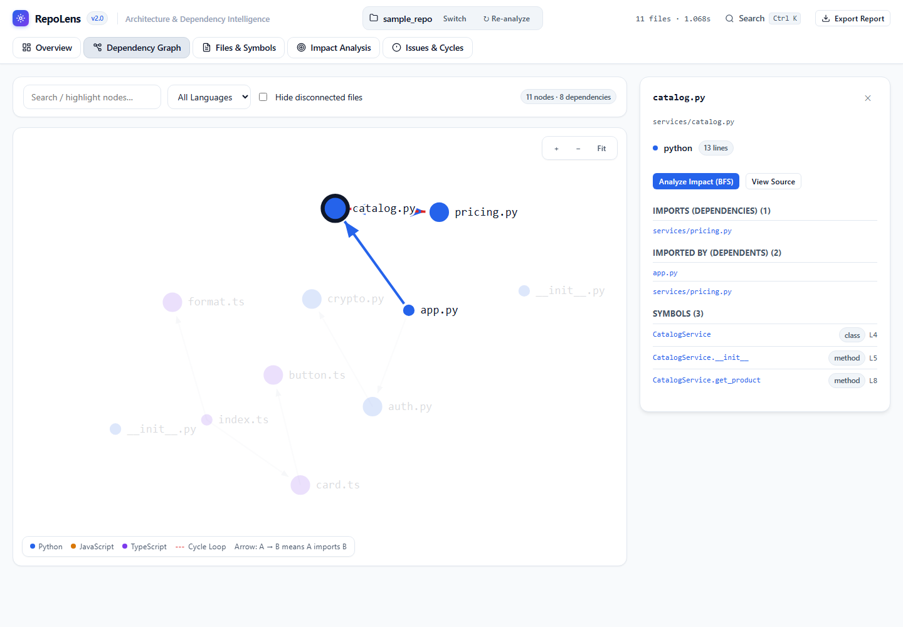
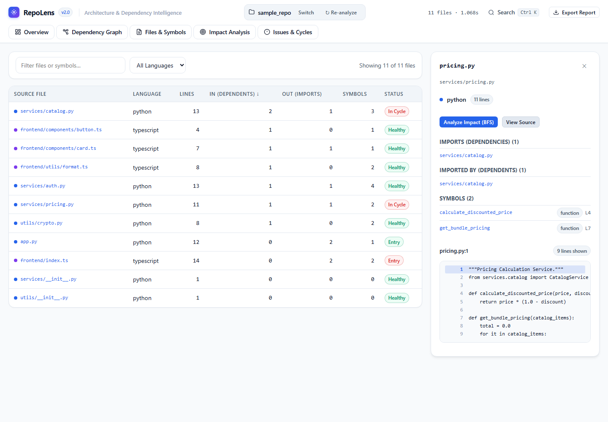
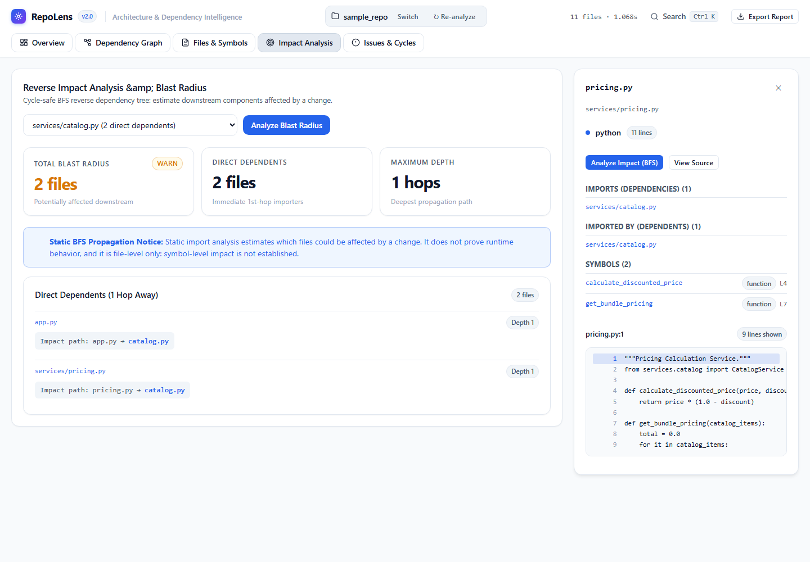
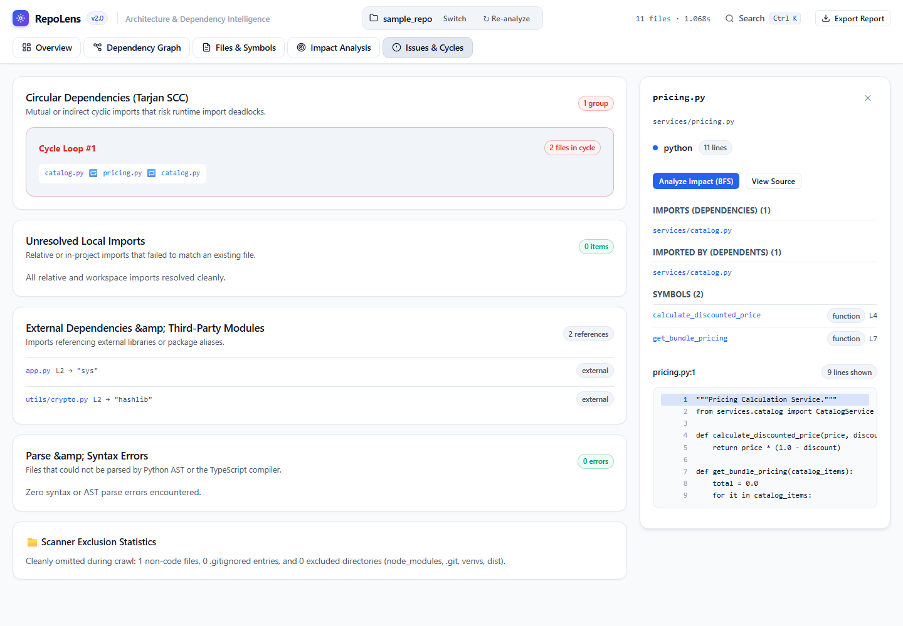

# RepoLens V2 — Codebase Architecture & Dependency Intelligence

[-success)](tests/test_repolens.py)
[](https://www.python.org/)
[](https://www.typescriptlang.org/)
[](LICENSE)
[]()

**RepoLens** is a local, static codebase architecture explorer and dependency intelligence platform for Python, JavaScript, and TypeScript repositories. It audits module definitions, maps import relationships without executing untrusted code, detects circular dependencies via Tarjan's Strongly Connected Components algorithm, calculates change blast radiuses using cycle-safe BFS, and exports audit-ready Markdown architecture reports.

---

## What the Interface Looks Like

### Overview Dashboard


---

## Visual Walkthrough & Gallery

### 1. Interactive Dependency Graph
Inspect force-directed import relationships, highlight circular dependency loops, zoom/pan across modules, and filter by language or connection status.


### 2. Deep Files & Symbols Inspector
Explore lines of code, in-degree and out-degree fan metrics, declared symbols (classes, methods, functions), and safely escaped source code excerpts with line numbers.


### 3. Change Blast Radius & Impact Analysis
Calculate downstream ripple effects before refactoring. Walks reverse dependency paths using cycle-safe Breadth-First Search (BFS) to show exact propagation breadcrumbs.


### 4. Issues & Tarjan SCC Circular Dependency Detection
Identify recursive import knots, unresolvable relative imports, third-party library dependencies, and syntax errors.


---

## Why Developers Use RepoLens

- **Audit Complex Codebases Instantly**: Understand legacy systems and new repositories without reading thousands of files line-by-line.
- **Prevent Circular Import Deadlocks**: Catch mutual dependency loops (`A → B → C → A`) before deployment.
- **Refactor Safely with Blast Radius Analysis**: Know exactly which downstream files will be impacted before modifying a core module or shared utility.
- **100% Static & Safe**: Zero execution of scanned files. No code is imported, run, or evaluated. Untrusted code cannot trigger side effects.
- **Zero Cloud Exfiltration**: Runs on `127.0.0.1` (localhost). Source code never leaves your computer.

---

## Key Capabilities

- **Multi-Language AST Parsing**:
  - **Python**: Native `ast.parse` extracts classes, methods, functions, standard imports, relative package imports (`.`, `..`), and `__main__` entry-point guards.
  - **JavaScript & TypeScript**: Powered by the official TypeScript compiler AST API (`jsparse.js`) for ES module imports/exports, CommonJS `require()`, re-exports, dynamic `import()`, interfaces, and classes.
- **Dual Source Ingestion Modes**:
  - **Mode 1: Local Directory**: Direct path analysis of any workspace folder.
  - **Mode 2: Public GitHub Repository**: Shallow clone (`--depth 1`) into an isolated sandbox temporary directory, AST analysis, and automatic cleanup.
  - **Bundled Quick-Start Fixture**: One-click "Load Sample Repository" button using a real multi-language test suite.
- **Graph & Topology Analysis**:
  - Directed import graph (`A → B` means `A` imports `B`).
  - Tarjan Strongly Connected Components (SCC) cycle detection.
  - Cycle-safe BFS impact analysis with propagation distance grouping.
  - Fan-in (most depended-upon) and fan-out (heaviest consumer) metrics.
- **Command Palette (`Ctrl+K` / `⌘K`)**: Instant fuzzy search across all files, functions, classes, and methods.
- **Audit Markdown Report Export**: Generates a comprehensive architectural audit report downloadable directly from the browser.

---

## Architecture & How It Works

```
┌────────────────────────────────────────────────────────┐
│                   Browser Frontend                     │
│   (Single-file vanilla HTML5 / CSS Tokens / JS Engine) │
└──────────────────────────▲─────────────────────────────┘
                           │ HTTP (127.0.0.1:8765)
┌──────────────────────────▼─────────────────────────────┐
│               RepoLens Server (server.py)              │
│    ThreadingHTTPServer, CSP headers, origin check,     │
│       in-memory snapshots, temporary sandbox manager   │
└──────────────────────────▲─────────────────────────────┘
                           │
       ┌───────────────────┴───────────────────┐
       ▼                                       ▼
┌──────────────┐                       ┌──────────────┐
│  Python AST  │                       │ TypeScript   │
│   (Native)   │                       │ Compiler API │
│  ast.parse   │                       │ (jsparse.js) │
└──────────────┘                       └──────────────┘
```

1. **Scanner (`repolens/scanner.py`)**: Walks target files (`followlinks=False`), enforces repository boundaries, respects `.gitignore`, and filters non-code directories (`node_modules`, `.git`, `__pycache__`, venvs, dist).
2. **Analysis Engine (`repolens/engine.py`)**: Parses Python AST and Node.js TypeScript compiler ASTs, resolves local and external module specifiers, identifies entry points, runs Tarjan SCC for cycle detection, and computes BFS reachability.
3. **Sandbox Manager (`repolens/github.py`)**: Validates GitHub URLs, shallow-clones (`--depth 1`, `--config core.symlinks=false`) without shell interpolation, enforces timeouts, and guarantees filesystem cleanup.
4. **HTTP Server (`server.py`)**: Serves the lightweight frontend and REST API over loopback `127.0.0.1`.

---

## Prerequisites

- **Python**: 3.10+ (tested on Python 3.13)
- **Node.js**: 16+ (tested on Node.js v20 & v22)
- **TypeScript**: `^5.0.0` (required for JavaScript/TypeScript parsing)
- **Git**: Required for GitHub public repository analysis

---

## Installation & Setup

### 1. Clone RepoLens

```sh
git clone https://github.com/Vikaspatel088/repolense.git
cd repolense
```

### 2. Install TypeScript Parser Dependency

```sh
# Install TypeScript locally
npm install

# Alternatively, if you have TypeScript installed globally:
# npm install -g typescript@5
```

---

## Running RepoLens

### Start the Server

**Windows PowerShell:**
```powershell
python server.py 8765
```

**macOS / Linux:**
```bash
python3 server.py 8765
```

Open your browser and navigate to:
```
http://127.0.0.1:8765
```

### Stopping the Server
Press `Ctrl+C` in your terminal to cleanly stop the server process and remove any active temporary clone directories.

---

## How to Analyze a Repository

### Option A: Local Directory
1. Choose the **Local Directory** tab on the home screen.
2. Enter the absolute path to your repository:
   - **Windows**: `C:\Users\username\projects\my-app` (Tip: Shift+Right-Click folder in Explorer and select "Copy as path").
   - **macOS / Linux**: `/home/user/projects/my-app`
3. Click **Analyze Repository**.

### Option B: Public GitHub Repository
1. Choose the **Public GitHub Repository** tab.
2. Enter the public repository URL (e.g. `https://github.com/pallets/flask`).
3. Click **Clone & Analyze**. RepoLens will shallow-clone to an isolated temporary sandbox, analyze the ASTs, and present the full architecture dashboard.

### Option C: Try Bundled Sample Fixture
Click **Load Sample Repository** to test RepoLens on the bundled multi-language fixture (`repolens/sample_repo`).

---

## Automated Test Suite

Run the full Python test discovery suite:

```sh
python -m unittest discover -s tests -v
```

Syntax check the TypeScript parser engine:

```sh
node --check repolens/jsparse.js
```

Run Playwright browser automation & screenshot verification:

```sh
python verify_and_screenshot.py
```

### Exact Observed Test Results

```
test_flow_and_errors (test_repolens.TestAPI.test_flow_and_errors) ... ok
test_github_analyze_validation (test_repolens.TestAPI.test_github_analyze_validation) ... ok
test_sample_endpoint (test_repolens.TestAPI.test_sample_endpoint) ... ok
test_security_boundaries_and_allowed_root (test_repolens.TestAPI.test_security_boundaries_and_allowed_root) ... ok
test_cleanup_guard (test_repolens.TestGitHub.test_cleanup_guard) ... ok
test_invalid_urls (test_repolens.TestGitHub.test_invalid_urls) ... ok
test_url_parsing (test_repolens.TestGitHub.test_url_parsing) ... ok
test_cycle_and_impact (test_repolens.TestGraph.test_cycle_and_impact) ... ok
test_empty_repo (test_repolens.TestGraph.test_empty_repo) ... ok
test_search (test_repolens.TestGraph.test_search) ... ok
test_imports_exports (test_repolens.TestJS.test_imports_exports) ... ok
test_js_dynamic_and_boundary_imports (test_repolens.TestJS.test_js_dynamic_and_boundary_imports) ... ok
test_js_extension_and_dir_resolution (test_repolens.TestJS.test_js_extension_and_dir_resolution) ... ok
test_defs_and_entry (test_repolens.TestPython.test_defs_and_entry) ... ok
test_edges_direction_and_resolution (test_repolens.TestPython.test_edges_direction_and_resolution) ... ok
test_malformed_utf8_recovery (test_repolens.TestPython.test_malformed_utf8_recovery) ... ok
test_nested_packages_and_relative_imports (test_repolens.TestPython.test_nested_packages_and_relative_imports) ... ok
test_self_import_no_loop (test_repolens.TestPython.test_self_import_no_loop) ... ok
test_similar_names_not_linked (test_repolens.TestPython.test_similar_names_not_linked) ... ok
test_unresolved_and_errors (test_repolens.TestPython.test_unresolved_and_errors) ... ok
test_bad_paths (test_repolens.TestScanner.test_bad_paths) ... ok
test_gitignore_and_excludes (test_repolens.TestScanner.test_gitignore_and_excludes) ... ok
test_limits (test_repolens.TestScanner.test_limits) ... ok
test_symlink_not_followed (test_repolens.TestScanner.test_symlink_not_followed) ... skipped (Windows SeCreateSymbolicLinkPrivilege requirement)

----------------------------------------------------------------------
Ran 24 tests in 5.8s: 23 passed, 1 skipped (Windows symlink privilege), 0 failures.
```

---

## Security Model & Privacy Guarantees

- **Local-Only Binding**: RepoLens strictly binds to `127.0.0.1` (loopback). It cannot be reached across local networks or the internet.
- **Zero Execution of Analyzed Code**: Source code is parsed into Abstract Syntax Trees via Python's standard `ast` library and TypeScript compiler APIs. Code is never imported into runtime, executed, or evaluated.
- **Isolated GitHub Sandbox**:
  - Clones are restricted to shallow depth (`--depth 1`).
  - Symlinks are disabled during clone (`--config core.symlinks=false`).
  - Clones reside in isolated operating system temporary directories.
  - Subprocess execution uses safe argument lists (`shell=False`) to prevent command injection.
  - Clones are cleaned up immediately on server shutdown or when a new repository is analyzed.
- **Path Traversal Defenses**:
  - Target paths are validated using `os.path.realpath`.
  - All source file reads must reside strictly inside the repository root.
  - API endpoints reject directory traversal (`..`) with HTTP 404.
- **Sanitized Public Responses**: Internal memory structures, raw absolute filesystem paths, and internal indexes are stripped from public responses.
- **Content Security Policy (CSP)**: Enforces `default-src 'self'; frame-ancestors 'none'`.

---

## Known Limitations

1. **Static Specifiers Only**: Dynamic imports with computed variables (`import(someVar)` or `importlib.import_module(mod)`) cannot be statically linked to dependency graph edges.
2. **TypeScript Path Mapping**: Custom path aliases configured in `tsconfig.json` (`@components/*`) are reported as `external-or-alias`.
3. **Public Repositories Only**: GitHub repository cloning is restricted to public repositories; private repositories requiring OAuth or personal access tokens are not accessed.
4. **Symlink Creation on Windows**: Running unit tests that construct new symbolic links on Windows requires Developer Mode or elevated privileges (`SeCreateSymbolicLinkPrivilege`). The scanner safely ignores existing symlinks on all operating systems.

---

## Product Roadmap

- [x] **v2.0**: Premium light-first developer workspace redesign.
- [x] **v2.0**: Public GitHub shallow clone sandbox workflow.
- [x] **v2.0**: Real fixture bundled sample repository.
- [x] **v2.0**: Interactive SVG force-directed graph with fit-to-screen controls.
- [x] **v2.0**: Cycle-safe BFS change blast radius impact analysis.
- [x] **v2.0**: Automated Playwright browser verification suite and screenshots.
- [ ] **v2.1**: Support for Rust and Go AST static parsing.
- [ ] **v2.2**: `tsconfig.json` path mapping alias resolution.
- [ ] **v2.3**: Interactive side-by-side graph diff comparing two git branches.

---

## License

Distributed under the MIT License. See [LICENSE](LICENSE) for more information.
